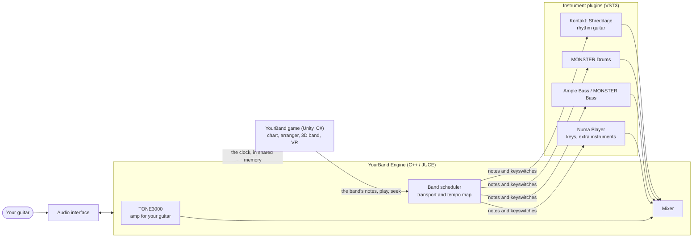

<div align="center">

# 🎸 YourBand

### A band that plays along with you.

Plug in your guitar. A drummer, a bassist, a keyboardist and a second guitarist play the song's real parts around you,
on real instrument plugins, in front of you on the screen or in your own room in VR.


-000000?logo=unity&logoColor=white)


</div>

YourBand is a practice tool and jam partner for guitarists, not a scored game. Open a song, count in, and the band
is there: **the drummer hits what the song's drum track says, the bassist walks the bass line, the keyboardist
plays the piano part, the rhythm guitarist picks the real fingerpicking pattern**. Your own guitar goes through an
amp simulation in the same program, so you hear yourself and the band together with a few milliseconds of latency.

> **Status:** an early personal project, built for Windows. It works, but expect rough edges.
> The band's parts, the chart and the mixer are finished; listening to you play and following your tempo are
> planned, not built (see [Roadmap](#-roadmap)).

## ✨ What it does

- **Real parts from real songs.** Import a Guitar Pro file (`.gp`, `.gpx`, `.gp3`-`.gp5`) and every instrument
  can play one of its tracks: General MIDI drums, the bass line, the keyboards, the rhythm guitar picked string
  by string so the bass notes ring under the pinches, leads with their bends, slides, vibrato, hammer-ons and palm
  mutes. Each instrument has a dropdown for its track; the game connects them sensibly by itself and remembers your
  choices per song.
- **A band for any song, too.** Without a Guitar Pro file the band makes up its parts from the chords and the
  strumming pattern, in three playstyles (Ballad, Rock, Pop), and counts you in on sticks.
- **A chart you can play from.** Chord diagrams drawn from the song's voicings, the strumming pattern with the
  stroke lit as it is played, a scrolling tab with bar numbers, lyrics at their beats, a section map to jump
  around, practice speed in 5 % steps, and an overview (`M`) of which track plays in which bar.
- **Your guitar, your amp.** The engine hosts the [TONE3000](https://www.tone3000.com/plugin/download) amp plugin
  for your guitar and switches its presets from a footswitch (any USB game controller, or an Arduino pedal).
- **A 3D band** (an optional download). Press `V` and four musicians play every note on their instruments: the
  drummer's sticking on the drums and cymbals, the guitarist's fingers on the real frets, the bassist's plucks, the
  keyboardist's keys.
- **Mixed reality.** In VR (Quest 3 through Virtual Desktop) the band stands in your room and the chart hangs
  on a board like a music stand; you place them with the controllers.
- **A real mixer.** Mute, solo, volume and pan per instrument (pan follows the musicians' places on stage),
  and a sound of its own for every instrument, playstyle and song.

<div align="center">


*The desktop screen with the built-in demo song: chords, strumming, tab and the chart.*

</div>

## 🚀 Get started

### 1. What you need

- Windows 10 or 11, 64-bit.
- An audio interface with an **ASIO** driver is strongly recommended: the author measured a 7.8 ms round trip with a
  Focusrite Scarlett Solo at 48 kHz and a 64-sample buffer. Built-in audio works for listening to the band; its
  latency is usually too high to play along through.
- A guitar and a cable, if you want to play along. The band works without.
- For VR: a Quest 3 and [Virtual Desktop](https://www.vrdesktop.net/).
- Free accounts at Native Instruments and Impact Soundworks for the guitar sound (below).

### 2. Download YourBand

Get the latest zip from the [Releases](https://github.com/barsk/YourBand/releases) page (or build it yourself: [Build from source](#-build-from-source)),
unzip it anywhere, for example to `Documents\YourBand`, and start `Game\YourBand.exe`. The game starts its audio
engine (`Engine\YourBand Engine.exe`) by itself and closes it when it closes. Nothing else needs installing for
the game and the engine; the band plays on plugins you install yourself.

**The 3D band is a separate, optional download** (about 100 MB): the same Releases page has a *band pack* zip.
Unzip it into the release folder (the one with `Game` and `Engine` in it); it adds `Game\Band\band.bundle`, and `V`
shows the band.
Without it the game is exactly the same, minus the band view: the music, the chart and the audio band do not need it.

Without any plugins the band plays its built-in sounds: a synthesized drum kit, bass and guitar. The keyboards
have no built-in sound, so they are silent until Numa Player is installed. The plugins are what make it sound
like a band, so install them next.

### 3. Install the plugins

All of these are free. They are not bundled: each one has its own licence, and you install them yourself.

| Instrument | Plugin | Where to get it |
|---|---|---|
| Rhythm guitar | **Kontakt 8 Player** with **Shreddage 3 Stratus FREE** | [Native Access](https://www.native-instruments.com/en/specials/native-access/) installs both; see below |
| Bass | **Ample Bass P Lite** (or MONSTER Bass) | [Ample Sound](https://www.amplesound.net/en/pro-pd.asp?id=19) |
| Drums | **MONSTER Drums** | [Monster DAW on KVR](https://www.kvraudio.com/developer/monster-daw) (download links on the product pages) |
| Keyboards (and extra instruments) | **Numa Player** | [Studiologic](https://www.studiologic-music.com/products/numaplayer/) |
| Your guitar | **TONE3000 plugin** | [tone3000.com/plugin/download](https://www.tone3000.com/plugin/download) |

VST3 plugins go where their installers put them, `C:\Program Files\Common Files\VST3`; YourBand looks there. The
MONSTER plugins come as a folder with the plugin and its sound library: put it in a folder named
`monster_plugins\Library files\` next to the `Engine` folder, or install its `.vst3` in the VST3 folder.

#### Kontakt 8 Player and Shreddage 3 Stratus FREE (the rhythm guitar)

Shreddage is a sampled electric guitar that lives inside Native Instruments' free Kontakt Player. This is the
longest install; the guitar is worth it.

1. Download and install **[Native Access](https://www.native-instruments.com/en/specials/native-access/)**, Native
   Instruments' installer, and sign in with a free Native ID.
2. In Native Access open **Library**, then **Available**, choose the **Kontakt** category and install
   **Kontakt 8 Player** ([its free download page](https://www.native-instruments.com/en/products/komplete/samplers/kontakt-7-player/free-download/)
   has the details). If you already own the full Kontakt 8, skip this step: it plays Shreddage too.
3. Go to the **[Shreddage 3 Stratus Free](https://impactsoundworks.com/product/shreddage-3-stratus-free/)**
   page at Impact Soundworks, add it to the cart (the price is $0; a tip is optional) and check out. You receive
   a serial number.
4. Add the serial in Native Access. **Shreddage 3 Stratus FREE** (about 1 GB) appears under your library; install it.
   If it does not appear, press the refresh button in the top right corner of Native Access
   ([Impact Soundworks' FAQ](https://faq.impactsoundworks.com/article/61-shreddage-3-free-library-not-appearing-in-native-access)).
   The old "Shreddage 3 Free" for the full Kontakt has a serial that does *not* work in Native Access.

Kontakt then shows up as a VST3 plugin (`Kontakt 8.vst3`).

### 4. First start: audio and your guitar

1. Start `Game\YourBand.exe`. The demo song, *Practice Room*, is on screen. Press `Space` to count in and play.
2. Press `C` to open the engine's **control panel**. Choose your audio **Device** (your interface's ASIO
   driver), a 48 kHz sample rate and a small buffer (64 samples; raise it if you hear crackling). Pick your
   guitar's input channel in **Guitar input**.
3. **Guitar tone...** opens the TONE3000 plugin. Load an amp model and a cabinet (browse tones at
   [tone3000.com](https://www.tone3000.com)), and save them as presets: they appear in the list beside the button,
   and a footswitch steps through them.

<div align="center">


*The control panel (`C`): a row per instrument with the song's track it plays, its plugin, mute, solo, volume and pan.*

</div>

### 5. Set up the band's sounds (the step that matters)

Every instrument has a sound for each playstyle (Ballad, Rock, Pop). Set them once, save them as the defaults,
and every song you open starts with them.

1. In the control panel click **Band playstyle defaults...** (on the *Band style* line). A table opens: a row per
   band member, a column per playstyle, and in every cell a plugin dropdown and a **...** button for the plugin's own
   window.

   

2. Choose a plugin in each cell: *Rhythm guitar* **Kontakt (Shreddage)**, *Bass* **Ample Bass P Lite**,
   *Keyboards* **Numa Player**, *Drums* **MONSTER Drums**. Numa Player starts on a sound chosen for each playstyle,
   and **Ample Bass plays at once**.
3. **MONSTER Drums and MONSTER Bass are silent until you choose a kit or a bass in them.** Click the **...**
   beside them, pick one in the plugin's window, and close it. (If the sound picker has gone, choose "Pick another
   sound in MONSTER ..." in the cell's dropdown.)
4. **Shreddage needs these settings.** Click **...** beside the rhythm guitar's **Kontakt**. In Kontakt open the
   *Libraries* tab and load the Shreddage 3 Stratus FREE instrument, then set:

   | Setting | Where | Value |
   |---|---|---|
   | Performance Style | Shreddage, *Main* tab, Performance Controls | **Rhythm** |
   | Fretting Mode | Shreddage, *Main* tab, Fretting Controls | **Polyphonic** |
   | Strumming Mode | Shreddage, *Strumming* tab | **Off** |
   | Keyswitchable | Shreddage, *Strumming* tab | **On** |
   | Voice limits | Kontakt, *Instrument Options* (the wrench in the instrument's header), *Voice Handling* (the names can differ a little between Kontakt versions) | **Standard 32, High Quality 16** |
   | Palm mutes (optional) | Shreddage, *Articulations* tab, *Map* | give **Mute** the rule `CC20 64-127` |

   Why: the band plays Shreddage's strings one by one and rings them like a guitarist's hand, so Strumming Mode
   has to be off (notes play as notes) and Keyswitchable on (the band can flip it for made-up strumming parts).
   The default voice limits (8 and 4) run out as soon as a few strings ring, and chords then lose notes or go
   silent: raise them. The mute rule makes palm-muted notes from a Guitar Pro file sound muted.
5. Close Kontakt's window: the sound, with these settings, is kept for the song and playstyle. Repeat for the
   playstyles you use (the game starts in Ballad below 120 BPM and in Rock from there; `B` switches).
6. Click **Save defaults** in the playstyle window. A song opened for the first time now starts with these
   sounds, and **Load defaults** gives them to a song that already has its own.

### 6. Add a song and play

- **Import new...** in the control panel takes a Guitar Pro file (and, optionally, an Ultimate Guitar chords page
  for its strumming), turns it into a song and opens it. `L` steps through your songs.
- Songs are not included: import your own. They stay on your computer in `songs-local\` and are never uploaded.

> The Ultimate Guitar import reads pages you have open. Their terms do not allow automated scraping and the
> lyrics are licensed content, so use it for your own practice and see [docs/plan.md](docs/plan.md#legal).

| Key | Does |
|---|---|
| `Space` | play / pause (a count-in first from the top) |
| `R` / `Home` | restart with a count-in / back to the top |
| `←` `→` / `PgUp` `PgDn` | a bar / a section back or on |
| `↑` `↓` | practice speed, 5 % steps |
| `1` `2` `3` `4` | show the song, chords, strumming and tab panels |
| `Tab` | the tab panel shows the next track the band plays |
| `M` | the tracks overview, bar by bar; click a bar to go there |
| `B` / `P` | the next band playstyle / strumming pattern |
| `V` / `X` | the 3D band view / VR mode |
| `C` / `T` | the control panel / your guitar's tone |
| `H` | help |

Want to play the rhythm yourself? Set the *Rhythm guitar* row to **None**. **None** takes any instrument out of
the band in that song, and each song remembers it.

## 🧠 How it works

Two programs talk over a local connection. The audio engine owns the audio interface and the plugins; the game
draws the chart and the band and writes the band's parts.



- The **game** turns a song (chords, tab, tracks) into notes for each instrument (`game/Assets/YourBand/Core/Band`),
  and plays the musicians' animation from the same notes, so every hit you see is a note you hear.
- The **engine** plays those notes on the song's tempo map, hosts the plugins, mixes, and publishes its sample clock
  so the game draws in sync with the sound. Your guitar goes straight through the engine's low-latency path.
- The two are separate programs on purpose: a plugin crash cannot take the game down, and the engine's JUCE
  licence does not touch the game.

## 🛠 Build from source

<details>
<summary>What you need, and the commands</summary>

You need Git with [Git LFS](https://git-lfs.com/) (the screenshots are LFS files, a few MB), the Unity Editor **6000.6.7f1**,
the Visual Studio Build Tools with the C++ workload (CMake and Ninja come with them), the .NET 8 SDK (for the
song importer) and Python 3.

```powershell
git clone https://github.com/barsk/YourBand.git
cd YourBand

# the engine: JUCE is fetched, not committed
git clone --depth 1 --branch 9.0.4 https://github.com/juce-framework/JUCE.git engine\third_party\JUCE
engine\build.cmd                     # engine\build\Release\gt_engine_artefacts\Release\YourBand Engine.exe

# the song importer
dotnet build tools\songtool -c Release

# the game (Unity in batch mode), then run it
game\build_desktop.cmd               # game\Builds\Desktop\YourBand.exe
game\run_tests.cmd                   # the EditMode tests

# a release zip, as in step 2 (and the band pack's zip, if the pack is built)
tools\make_release.cmd -Build
```

The **3D musicians are not in the repository**: they have their own licences and are big (Microsoft Rocketbox
avatars, Mixamo animations, instrument models). The game loads them from the optional *band pack*
(`Band\band.bundle` next to the game). To see the band in a build from source, download the pack from
[Releases](https://github.com/barsk/YourBand/releases) and unzip it into `game\Builds\Desktop` (or `game\` for the
Unity Editor); [docs/band-assets.md](docs/band-assets.md) also tells how to make the pack yourself.

JUCE is used under the AGPLv3 while the project is personal; a commercial JUCE licence may be required before
publishing a product (see [CREDITS.md](CREDITS.md)).

</details>

## 📁 What is where

| Folder | |
|---|---|
| [`game/`](game/README.md) | The Unity game: song model, chart, the band's arranger, the desktop screen, the 3D band, VR |
| [`engine/`](engine/README.md) | The C++ audio engine and its control panel: devices, plugins, the band's playback, the mixer |
| [`tools/`](tools/songtool/README.md) | `songtool` (importers for Guitar Pro and Ultimate Guitar pages, MIDI export), the release script, the 3D band's asset pipeline |
| [`schema/`](schema/engine-protocol.md) | The messages between the game and the engine |
| [`docs/`](docs/plan.md) | The game plan, the instrument-tracks design, the band's 3D assets, venue ideas, and the hand-capture experiment |
| [`capture/`](docs/capture.md), `markers/`, `mockup/` | Python and Blender work behind the hand capture and the 3D instruments |

Design and background: [docs/plan.md](docs/plan.md) (the whole plan),
[docs/instrument-tracks.md](docs/instrument-tracks.md) (how the band plays real tracks, with the measurements behind
it), [docs/capture.md](docs/capture.md) (video to hands).

## 🗺 Roadmap

Built: the chart and its panels; the band on plugins with real tracks, techniques, per-song sounds and a mixer; the
3D band; VR mode; song import; the footswitch.

Planned: listening to your guitar (tuner, strums, chord check, learning your timing), following your tempo and a
rule-based bandleader that keeps the groove going when you pause and plays fills, voice commands, venues for the
desktop view, and a teacher avatar. See [docs/plan.md](docs/plan.md).

## 🙏 Credits and licences

YourBand stands on other people's work: JUCE, TONE3000, the plugins above, Microsoft Rocketbox, Mixamo and more. Every
asset and library, its source and its licence is in [CREDITS.md](CREDITS.md). YourBand is not affiliated with or
endorsed by Native Instruments, Impact Soundworks, Studiologic, Ample Sound, Monster DAW or TONE3000.

## 📜 Licence

YourBand's source code is licensed under the **[GNU General Public License v3.0](LICENSE)**. The third-party assets
and libraries it uses keep their own licences, listed in [CREDITS.md](CREDITS.md); the audio engine includes JUCE
under the AGPLv3.
