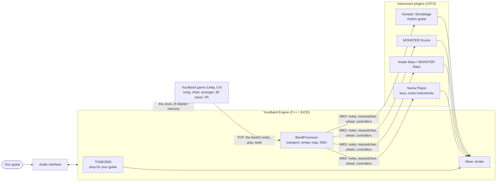
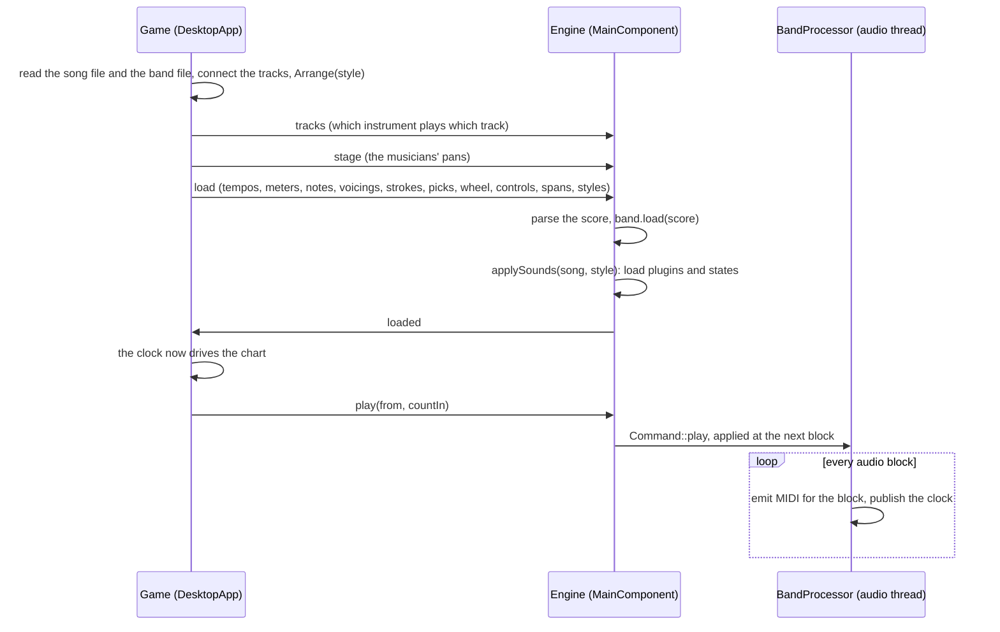

# YourBand architecture

How YourBand is built: the two programs and what each owns, how a song becomes sound and animation, the threads and
the real-time rules, the messages between the programs, and where everything is kept on disk. It describes the code as
it is (November 2026); [plan.md](plan.md) is the design history and what is still planned.

Companion documents:

| Document | What it covers |
|---|---|
| [band-arrangement.md](band-arrangement.md) | How the game writes the band's parts: the made-up drums, bass, keys and guitar, and the parts played from a Guitar Pro track, with their techniques |
| [shreddage-keyswitches.md](shreddage-keyswitches.md) | How the rhythm guitar drives Shreddage 3.5 Stratus FREE: strum and string keyswitches, bends, slides, vibrato, palm mutes |
| [../schema/engine-protocol.md](../schema/engine-protocol.md) | The messages between the game and the engine, and the clock's memory layout |
| [instrument-tracks.md](instrument-tracks.md) | Design notes for playing a song's real tracks, with the measurements behind them |
| [band-assets.md](band-assets.md) | The 3D band and its optional pack |

## 1. Overview

YourBand is two programs on one Windows PC that talk over a local connection.

| | Audio engine | Game |
|---|---|---|
| Language, framework | C++17, JUCE 9 | C#, Unity 6 (URP) |
| Program | `YourBand Engine.exe` | `YourBand.exe` |
| Owns | The audio interface, the plugins (instruments and your guitar's amp), the transport, the mixer, the footswitch, the clock | The song, the chart and the other screens, the arrangement (what each band member plays), the 3D band, VR |
| Does not own | What the band plays (it plays whatever notes it is given) | Any sound |
| Source | [`engine/`](../engine/README.md) | [`game/`](../game/README.md) |



The rules that shape everything else:

1. **The engine plays notes; the game decides which.** The game turns a song into one list of notes per band member
   (the *arrangement*) and hands it to the engine. The engine knows nothing about chords, strumming patterns or Guitar
   Pro files.
2. **The engine owns time.** It is the music: it runs the transport, and the game only asks it to play, pause, seek or
   change speed. The game draws at the position the engine publishes.
3. **Positions are quarter notes** from the start of the song, in every message and every data structure. The tempo
   map turns quarter notes into bars and seconds.
4. **The two are separate programs on purpose.** A plugin that crashes takes the engine down, not the game; the engine
   can be built and tested alone (a silent mode records the band to a WAV file); and JUCE's licence (AGPLv3) stays in the
   engine.
5. **The game works without the engine** (it keeps time silently on a wall clock, for the chart and screenshots), and
   without the 3D band (an optional download, [band-assets.md](band-assets.md)).

## 2. Repository map

| Folder | Contents |
|---|---|
| `game/` | The Unity project. Code in `Assets/YourBand/` ([section 3](#3-the-game)) |
| `engine/` | The JUCE audio engine: `src/` (the program), `tools/` (plugin probe and Python test sessions), `third_party/JUCE` (fetched, not committed) |
| `tools/songtool/` | A command-line build of the game's `Core` code: song importers, `show`, `band-midi` |
| `tools/band_assets/` | Gathers the 3D band's sources into the Unity project |
| `tools/make_release.*`, `tools/release/` | The release zips and what goes in them |
| `schema/` | The message protocol between the programs |
| `docs/` | These documents, the plan, screenshots |
| `capture/`, `markers/`, `mockup/` | Python and Blender work behind the hand-capture experiment and the 3D instruments |
| `songs-local/` | Your imported songs (not in git) |

## 3. The game

### 3.1 Assemblies and the dependency rule

`Assets/YourBand/` is split into assemblies so that the dependency rule is enforced by the compiler:

| Assembly | Folder | Rule |
|---|---|---|
| `YourBand.Core` | `Core/` | Plain C#, no Unity references (`noEngineReferences`). The song model, timing, importers, the arranger, the protocol. Tested without a scene, and compiled by `songtool` for the command line |
| `YourBand.Runtime` | `Runtime/` | Unity code: screens, the 3D band, VR, the connection to the engine. Depends on `Core`, never the reverse |
| `YourBand.Editor` | `Editor/` | Project setup and the build, from code (`ProjectSetup`, `BandSetup`, `VrSetup`) |
| `YourBand.Core.Tests` | `Tests/EditMode/` | NUnit tests of `Core` (92 tests; `game\run_tests.cmd`) |

### 3.2 Module inventory

| Path | Responsibility |
|---|---|
| `Core/Music/` | `TempoMap` (quarter notes to bars and seconds, and back; meters; tempo changes), `Chord` and `ChordName` (a chord name as root, intervals and slash bass) |
| `Core/Songs/` | `Song` (the layered song model, [3.3](#33-the-song-model)), `SongJson` (versioned JSON on disk), `SongOrigin` (where each part came from, for the log), `DemoSong` |
| `Core/Chart/` | `SongChart`: the song laid out bar by bar, and what to show at a position (the bar, the chord, the lyric words sung, the strumming stroke) |
| `Core/Import/` | The Ultimate Guitar importer (`UgPage`, `ChordSheet`, `UgImporter`). The Guitar Pro importer is in `tools/songtool/GpxImporter.cs` ([3.4](#34-importing-songs)) |
| `Core/Band/Arranger.cs` | The band's parts for a song in a style ([band-arrangement.md](band-arrangement.md)); `BandStyle` (Ballad, Rock, Pop) |
| `Core/Band/BandConnections.cs` | Which track of the song each instrument plays; the automatic connection; "None" |
| `Core/Performance/` | How a musician's hands play the arranged notes: the drummer's sticking, the guitarist's grips and strokes, the bassist's strings and frets. Used by the 3D band |
| `Core/Playback/` | `Transport` (the interface the screens use), `SongClock` (a wall-clock transport: play, pause, seek, speed, count-in) |
| `Core/Engine/EngineProtocol.cs` | Builds the messages for the engine, and the clock snapshot ([5](#5-the-link-between-them)) |
| `Runtime/Desktop/DesktopApp.cs` | The application: loads a song, owns the transport, arranges the band, talks to the engine, handles keys, takes screenshots |
| `Runtime/UI/` | The desktop screen in UI Toolkit: chart rows, chord diagrams, strumming view, scrolling tab, tracks overlay (`M`), loading ring. Styles in `Chart.uss` |
| `Runtime/Engine/` | `EngineProcess` (starts the engine), `EngineLink` (the TCP connection), `EngineClock` (reads the shared-memory clock), `EngineTransport` (a `Transport` backed by the engine) |
| `Runtime/Band/` | The 3D musicians: `BandStage`, `Musician` and its `Drummer`, `GuitarPlayer`, `KeysPlayer`; `InstrumentFrame` (the instrument's playing geometry), `HandRig` and `Ik` (hands onto frets, strings, keys, drums) |
| `Runtime/Vr/VrMode.cs` | Mixed-reality mode (OpenXR, chroma-key passthrough, the board, moving the band) |
| `Runtime/Songs/SongLibrary.cs` | Finds the song files in `songs-local/` |
| `Runtime/Settings/LegacyData.cs` | One-time take-over of the settings saved under the game's old name |
| `Runtime/Testing/` | `KeyScript` and `VrScript`: scripted keys and VR controllers on the game's own input, for tests |

### 3.3 The song model

`Core/Songs/Song.cs` holds a song in layers ([plan.md](plan.md#song-data)). All positions are quarter notes.

| Layer | Contents |
|---|---|
| Skeleton | Sections, chords (`ChordEvent`: name, start, length, voicing name), lyrics (words at positions) |
| Rhythm guitar | Strumming patterns (a grid of strokes: down, up, muted, accent, rest), chord voicings (frets and fingers per string, barre) |
| Lead and riffs | `Riffs`: tab notes (string, fret) |
| Timing | `Tempo` (the `TempoMap`), `Info` (key, capo, tuning, time signature) |
| Tracks | `Tracks`: every track of a Guitar Pro file as written, with its notes ([below](#track-notes)). Empty for a song from Ultimate Guitar pages |
| Provenance | `Sources`: which file or page each part came from |

<a id="track-notes"></a>

A **`TrackNote`** is what the band plays from a Guitar Pro track:

| Field | Meaning |
|---|---|
| `AtQuarter`, `Quarters` | Start and length |
| `Pitch` | The sounding MIDI pitch, capo included; on a drum track the General MIDI drum note |
| `StringIndex`, `Fret` | The string (0 lowest) and fret where the track is tab, else -1 |
| `Velocity` | 1-127 from the written dynamics (ppp 15 to fff 127), accents and ghost notes |
| `Technique` | A letter each: `b` bend, `s` slide, `h` hammer-on or pull-off, `~` vibrato, `m` palm mute, `x` dead note, `g` ghost, `a` accent, `.` staccato, `r` let ring, `n` harmonic, `t` tapped, `z` tremolo picking, `q` grace note; `D` / `U` the stroke the file records (its pick stroke, else its brush or arpeggio) |
| `Bend`, `BendPoints` | A bend's top in semitones, and its shape as [where in the note 0-1, semitones] points |
| `SlideOut`, `SlideIn` | `shift`, `legato`, `down`, `up` out of the note; `below`, `above` into it |
| `Vibrato` | `slight` or `wide` |
| `TremoloQuarters` | The repeated note's length for tremolo picking |

Songs are JSON files (`SongJson`, versioned) in `songs-local/<name>.song.json`.

### 3.4 Importing songs

| Source | Path |
|---|---|
| Guitar Pro (`.gp`, `.gpx`, `.gp3`-`.gp5`) | `tools/songtool/GpxImporter.cs`, reading the file with the alphaTab library (kept in `songtool` so the game never depends on it). The song is read in the order it is **played**: repeats, alternate endings and jumps (Da Capo, Dal Segno, Coda) are unrolled as alphaTab's player and TuxGuitar do, so every bar number is a bar as played. Every track with notes is kept in `Tracks`; tracks with identical notes are merged (`SameAs`) |
| Ultimate Guitar chords and tabs pages | `Core/Import/UltimateGuitar/`: sections, chords, lyrics, strumming patterns, chord shapes (chords page), riffs (tabs page) |
| Both | A Guitar Pro song may take its strumming from a chords page (`--strum`); where sources disagree the song records the alternatives |

The control panel's **Import new...** button runs `songtool import`, which writes the song to `songs-local/` and tells
the game (`importedSong`). The importers and `songtool`'s other commands (`show`, `band-midi`, `gpx-info`) are
documented in [`tools/songtool/README.md`](../tools/songtool/README.md).

### 3.5 The frame loop

Each frame `DesktopApp`:

1. polls the engine link (messages arrive on the main thread) and refreshes the transport from the engine's clock;
2. computes the position `quarter`, and from it the chart's state (bar, chord, stroke, lyric words);
3. updates the screen (`DesktopScreen.Show`), the 3D band (`BandStage.Show(quarter, seconds)`) and VR;
4. handles keys and, in VR, the controllers.

The 3D band does not wait for the engine to tell it what to play: it holds the same arrangement the engine has, so a
musician's arm can start moving before the note sounds.

## 4. The audio engine

### 4.1 Source map

| File | Contents |
|---|---|
| `Main.cpp`, `MainComponent.*` | The program, its command line (`--silent`, `--record`, `--run-for`, `--parent`, `--band-guitar`, `--snapshot`), the control panel, the handling of the game's messages |
| `EngineCore.*` | The audio device and the processing graph, plugin hosting, the mixer |
| `Band.*` | `Score` (what the band plays) and `BandProcessor` (plays it: the transport, MIDI generation, the Shreddage logic) |
| `Instruments.*` | The built-in drum kit, bass and guitar (used when a part has no plugin) |
| `Processors.h` | Gain, pan, MIDI channel filter, the soft limiter |
| `GameLink.*` | The TCP server for the game |
| `SharedClock.*` | The clock in shared memory |
| `SoundStore.*` | Each song's sounds, kept as JSON files |
| `NumaKeys.*` | Numa Player states for a named sound |
| `ImportWindow.*` | The control panel's import window (runs `songtool`) |
| `Footswitch.*` | HID game-controller reader (500 Hz) |
| `SilentDevice.*` | A pretend audio interface that keeps real time (for `--silent`) |
| `ParentWatch.*` | Closes the engine when the game that started it is gone |
| `WindowFront.*` | Lets the engine's windows come in front of the game |
| `tools/PluginProbe.cpp` | `plugin_probe`: loads a plugin without a window, plays phrases, reports levels (the measurements in these documents come from it) |

### 4.2 The processing graph

`EngineCore` builds one JUCE `AudioProcessorGraph`:

```
 instrument input --> TONE3000 (your guitar) ---------------------------------------------------------> outputs
                                                                                                             ^
 BandProcessor                                                                                               |
   audio 0-1 (built-in kit, count-in) --------------+                                                        |
   MIDI ch 10 --> drums plugin  ---------------------+--> Drums gain  --+                                    |
   audio 2   (built-in bass) -----------------------+                   |                                    |
   MIDI ch 2  --> bass plugin   ---------------------+--> Bass gain   --+                                    |
   audio 3   (built-in guitar) ----------------------+                   +--> Band bus (soft limiter) -------+
   MIDI ch 3  --> guitar plugin (Kontakt) ------------+--> Guitar gain --+
   MIDI ch 1  --> keys plugin (Numa Player) ------------> Keys gain   --+
   MIDI ch 4  --> lead 1 plugin ------------------------> Lead 1 gain --+
   MIDI ch 5  --> lead 2 plugin ------------------------> Lead 2 gain --+
```

- A part plays on its **plugin** when one is loaded and the part is switched to it, else on the built-in voice (drums,
  bass and guitar only; the keys and the two leads have no built-in sound).
- The band guitar plugin has an amp of its own: it goes straight to the mixer, as the built-in guitar does.
- Each plugin hears only its own MIDI channel (a `MidiChannelFilter` in front of it).
- Your guitar takes the low-latency path to the outputs and never goes through the band bus, so the band's mute, solo
  and limiter do not touch it.
- Each part's gain node (`GainProcessor`) holds its volume, pan and mute: the sound's own level (a measured figure per
  plugin) times the instrument's mixer controls ([4.6](#46-the-mixer)). The band bus is a gain node with a soft limiter
  (peaks above 0.7 bend towards 1) on the band's sum.
- When a plugin is swapped, the whole graph is rebuilt once and the audio thread switches from the old graph to the
  new one in one step (a rebuild per connection let it play half-connected graphs).

### 4.3 Threads and real-time rules

| Thread | Does |
|---|---|
| Audio (the device callback) | `BandProcessor::processBlock`, the plugins' `processBlock`, the clock write. Takes no locks and does not wait: commands arrive in a lock-free FIFO and a new score through an atomic pointer |
| Message (JUCE's) | The control panel, plugin windows, handling the game's messages, loading plugins and states, `SoundStore` |
| `GameLink` | Accepts the game's TCP connection, reads lines, posts them to the message thread; `send` may be called from any thread |
| `Footswitch` | Polls the controller at 500 Hz at high priority, posts commands |
| `ParentWatch` | Waits for the game process to exit, then asks the engine to close |

Everything the audio thread reads that the message thread can change is either atomic or handed over whole:

- **The score.** The message thread builds a `Score` (`Score::fromMessage`), `BandProcessor::load` stores it, and the audio
  thread adopts it at the start of the next block (resetting its cursors). Old scores are freed by the message thread
  once neither `pending` nor `inUse` points at them. A `Score` is read-only once the band has it.
- **The transport.** `play`, `pause`, `seek` and `speed` are `Command`s pushed to a FIFO and applied at the start of
  the next block.
- **Settings** such as which part is on a plugin, mute, the guitar's advance and its strumming mode are atomics.

The band is rendered in the audio callback today. [plan.md](plan.md#architecture) describes moving it to its own
thread, ahead of time, if the band grows; at 2-4 % of the audio budget it has not been needed.

### 4.4 BandProcessor

Per block, in this order (`Band.cpp`, `processBlock`):

1. Adopt a newly loaded score, if any.
2. Apply queued transport commands.
3. If playing: compute the block's span `[q0, q1)` in quarter notes from the tempo map and the speed.
4. The count-in: sticks on every beat, the first louder (the built-in kit).
5. Note-offs due in this block (before the new note-ons, so a re-struck chord lets go first).
6. The parts' **pitch wheels**: the value between two points at the block start, then each point at its moment.
7. The parts' **controllers** (the palm mute's CC20) at their moments.
8. The notes of drums, bass, keys and the leads (and the tab's single-string notes, which go to Lead 1 when it has a
   plugin).
9. The **band guitar**: the Shreddage logic of [shreddage-keyswitches.md](shreddage-keyswitches.md): single-string
   stretches, per-string notes, and, in strumming mode, the held chord, the strokes and the picks.
10. Advance `quarter`; render the built-in voices into the block.
11. Publish the clock (`quarter`, when it is heard, the rate).

The band keeps one **cursor** per list (notes, guitar notes, voicings, strokes, picks, spans, wheel points, controller
points). A seek, a play and a new score reposition all of them with a binary search, so playing from the middle of a
song, or after a count-in, is correct without replaying anything.

Which MIDI channel a part plays on: keys 1, bass 2, guitar 3, lead 1 4, lead 2 5, drums 10. A drum the kit in use does
not have is played on the nearest one it has (`drumStandIns`; the built-in kit has 12 drums, MONSTER Drums most of
General MIDI).

### 4.5 Plugin hosting

`EngineCore` hosts one plugin per slot: `guitar` (TONE3000), `bandDrums`, `bandBass`, `bandGuitar`, `bandLead1`,
`bandLead2`, `bandKeys`. Plugins are found by file name pattern in the VST3 folder and in `monster_plugins/Library files/`
(searched upward from the engine); "Other plugin..." takes any VST3 instrument.

- A plugin's **state** (its saved sound) is a binary block. `setPluginState` pauses the plugin's audio from before the
  change until it has had a settle time to load what the state names (Numa Player loads sounds in the background and once
  crashed the engine when played during a load; MONSTER Drums stopped when asked for its state while loading).
- A plugin is **strum-capable** if its file name starts with `Kontakt` (`MainComponent.cpp`): that selects the
  strumming-mode logic of the band guitar. Kontakt plays 20 ms early (`guitarAdvanceSeconds`) because a strummed
  Shreddage sounds that much late.

### 4.6 The mixer

Per instrument (rhythm guitar, bass, keys, drums, lead guitar, instrument 1): mute, solo, a volume knob (0 dB is the
balanced mix, up to +6 dB) and a pan knob. Solo silences the other *band* parts, never your guitar. Pan is equal power;
until you turn a knob an instrument pans from its musician's place on stage as the audience hears it (the game's `stage`
message, 45 degrees off centre being fully to one side). Volume, pan and mute are kept per song; solo is not.

### 4.7 Sounds per song

A *sound* is an instrument's plugin and its state. For each song the engine keeps (in `SoundStore`):

- per band playstyle (Ballad, Rock, Pop) the sound of the rhythm guitar, bass, keys and drums;
- per instrument that plays a track, the sound it plays that track on;
- the mix.

A song opened for the first time gets a copy of the saved defaults (`band-defaults.sounds`, written by **Save defaults**
in the Band playstyle defaults window). On `load` the engine puts the band on the playing playstyle's sounds, loading
only what differs, and then answers `loaded`; the game shows its loading ring until then. A silent engine reads the
files and never writes them.

## 5. The link between them

Full definitions are in [schema/engine-protocol.md](../schema/engine-protocol.md). In short:

- **Messages** go over TCP on `127.0.0.1:47800`: one JSON object per line. The engine listens, the game connects (and
  keeps trying while the engine is not up). One game at a time. The code is written by hand on both sides:
  `Core/Engine/EngineProtocol.cs` and `engine/src/GameLink.cpp` with `Band.cpp`.
- **The clock** is shared memory, `Local\YourBandClock` (64 bytes), written by the audio thread after every block and read
  by the game every frame. Messages are too late and too jittery for drawing in time with the sound.

| Direction | Messages |
|---|---|
| Game to engine | `hello`, `load` (the song's tempo map and the band's parts), `tracks`, `stage`, `play`, `pause`, `seek`, `speed`, `window`, `mix`, `songs`, `bandBass`, `quit` |
| Engine to game | `hello`, `loaded`, `command` (footswitch), `connect` (a track chosen in the control panel), `style`, `openSong`, `importedSong`, `deleteSong` |

### 5.1 The clock and what is heard

The engine publishes `(quarter, ticks, quarters-per-second, playing, count-in end)` where `ticks` is the Windows
performance counter at the moment the block's first sample is **heard** (the engine adds the output latency). The game
reads with a sequence number (odd while the engine writes; retry if it changed) and computes the position now:

`quarter + (now - ticks) / ticksPerSecond * quartersPerSecond`

So the chart and the musicians show what is being heard, not what was rendered.

### 5.2 Opening a song



Until `loaded` arrives the game runs on its own wall clock, so a song can be looked at while the plugins load.

### 5.3 Other flows

- **Choosing a track** for an instrument in the control panel: the engine sends `connect`; the game stores the choice in
  `<song>.band.json`, arranges the band again, and sends `tracks` and `load`.
- **Deleting a song**: the control panel's **Delete song...** asks first; then the engine moves the song's sounds file to the Recycle
  Bin and sends `deleteSong`, and the game moves the song file and the band file there too, reads its list again, opens the next
  song and sends `songs`. Both programs use the Recycle Bin, so nothing is lost for good.
- **Choosing a playstyle**: the engine sends `style`; the game arranges in that style and sends `tracks` and `load`.
- **Startup**: the game looks for a running engine; if there is none it starts `Engine\YourBand Engine.exe` hidden with
  `--parent <its process id>`, and the engine's `ParentWatch` closes it when the game is gone, even if the game crashes. An
  engine you started yourself is used as it is and left running.
- **Shutdown**: the game sends `quit` to an engine it started; the engine saves its settings.

## 6. Data on disk

| What | Where | Written by |
|---|---|---|
| Songs | `songs-local/<name>.song.json`, the Guitar Pro files in `songs-local/gpx/`, saved pages in `songs-local/pages/` | `songtool import` |
| Which track each instrument plays | `songs-local/<name>.band.json` | The game |
| Each song's sounds and mix | `%APPDATA%\YourBand\songs\<name>.sounds` (JSON; each plugin state is a JUCE base64 block, `<size>.<data>`) | The engine |
| Default sounds for new songs | `%APPDATA%\YourBand\band-defaults.sounds` | The engine ("Save defaults") |
| Engine settings (audio device, plugins, guitar input, TONE3000) | `%APPDATA%\YourBand\YourBand Engine.settings`, log `engine.log` beside it | The engine |
| Game preferences (window, panels shown, last song) | Unity `PlayerPrefs` (the Windows registry, under the game's company and product name) | The game |
| VR placement, floor height, key colour | `%USERPROFILE%\AppData\LocalLow\YourBand\YourBand\vr-settings.json` | The game |
| The 3D band | `Band\band.bundle` next to the game ([band-assets.md](band-assets.md)) | `BandSetup` |

The game was called GuitarTutor until 2026-11-12. At the first start under the new name each program takes over what the
old name saved and leaves the old copy where it was (`LegacyData.cs`; `keepSettingsFromGuitarTutor` in the engine).

## 7. Timing

- **Quarter notes everywhere.** The `TempoMap` (`Core/Music/TempoMap.cs`, and `Score::bpmAt` / `beatAt` in the engine)
  maps them to seconds and bars, with tempo changes and meter changes.
- **Practice speed** scales the rate (quarters per second) without changing any note's position; the engine clamps it to
  0.25-2.
- **The count-in** is a number of quarter notes before the start position, played as sticks; band notes inside it are not
  played, and `countInUntil` is in the clock so the screens can show it.
- **Block-accurate placement.** A note's MIDI event is placed at the sample inside the block where its quarter falls.
- **Early notes for slow sounds.** The band guitar's notes, keyswitches, wheel points and controllers all go out
  `guitarAdvance` early when it plays on Kontakt (20 ms), because a strummed Shreddage builds its sound that much late.
- **Note lengths are arranged, not left to the plugin.** The arranger decides how long each note rings, and the engine
  sends the note-off at that moment, so a plugin's sustain or release never decides.

## 8. The 3D band and VR

`BandStage.Create` loads the four musician prefabs from the band pack; each `Musician` is an avatar playing a looped
Mixamo clip held to the song's beat, with an instrument whose playing geometry (frets, strings, keys, drums) is a JSON
file next to its model (`InstrumentFrame`). `Core/Performance/` works out from the arrangement *who plays what with which
hand and where*; `HandRig` and `Ik` then place hands, fingers and sticks on the real targets in `LateUpdate`. Every hit
you see is a note in the arrangement.

VR mode (`VrMode`) starts OpenXR itself (Virtual Desktop's runtime), clears the camera to a key colour that Virtual
Desktop's passthrough replaces with the room, draws the chart on a board, and lets you move the board and the musicians
with the controllers. Where they stand is kept in `vr-settings.json` and sent to the engine as the pan of each
instrument.

## 9. Tests and tools

| Tool | For |
|---|---|
| `game\run_tests.cmd` | The EditMode tests of `Core` (batch mode; the project must not be open in the Editor) |
| `YourBand.exe -keys "2:Space,...,quit" -keyshots <dir>` | Scripted keys on the game's own keyboard, never the desktop's; screenshots on `shot` |
| `YourBand.exe -shot <dir> -at 1.75,17.75 ...` | Screenshots at song positions; `-cam`, `-view band`, `-vr -noxr` for the band and VR |
| `YourBand Engine.exe --silent --record out.wav --run-for 40` | The engine without a sound card, recording the band |
| `engine/tools/plugin_probe` | Loads a plugin headless, plays phrases, reports levels, bend range, key maps |
| `engine/tools/band_session.py`, `strum_session.py`, `switch_session.py`, `lead_session.py` | Silent end-to-end sessions; `wav_check.py` reads the recording |
| `songtool band-midi` | Writes the band guitarist's part as a MIDI file, exactly as the engine sends it to Shreddage, to look at in a DAW |
| `songtool show`, `gpx-info` | The chart bar by bar; a Guitar Pro file's tracks and play order |

## 10. Build and release

| Step | Command |
|---|---|
| Engine | `engine\build.cmd` (MSVC, CMake, Ninja; JUCE cloned into `engine\third_party`) |
| Game | `game\build_desktop.cmd` (Unity in batch mode: `ProjectSetup.BuildDesktop` sets the project up from code, builds the band pack, builds the player) |
| Song importer | `dotnet build tools\songtool -c Release` |
| Release | `tools\make_release.cmd -Build`: the game and engine zip, and the band pack's zip |

## 11. Planned, and not yet as planned

| In [plan.md](plan.md) | In the code |
|---|---|
| The band rendered ahead on its own thread | Rendered in the audio callback |
| The engine schedules notes 0.3-0.5 s ahead | The game holds the whole arrangement, so the musicians anticipate on their own; the engine places each note at its sample |
| The engine listens to your guitar (strums, chords, tempo) and the game follows you | Not built: your guitar is only amplified |
| The protocol and the C# and C++ code generated from `schema/` | Written by hand on both sides, kept in step |
| A footswitch of its own | A USB game controller (any HID joystick) works today |
