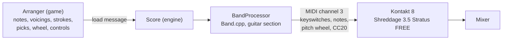

# Playing Shreddage 3.5 Stratus FREE from MIDI

How YourBand drives its rhythm guitar, **Shreddage 3.5 Stratus FREE** inside Native Instruments' Kontakt: how a chord is
made known to the plugin, how strums and single strings are triggered with keyswitches, and how bends, vibrato,
slides, hammer-ons, palm mutes and the rest are made to sound. It is a specification of what the code does, with the
measurements it rests on. Plugin behaviour quoted from the manual (*Shreddage 3.5 Stratus FREE Product Manual*, pages 15-17,
32-34) is marked as such; everything else was measured with `plugin_probe` (`engine/tools/PluginProbe.cpp`) or is the code.

Related: [band-arrangement.md](band-arrangement.md) (how the game writes the notes this document plays),
[architecture.md](architecture.md) (the engine around it), [schema/engine-protocol.md](../schema/engine-protocol.md)
(the `load` message).

## 1. Overview

A guitar part reaches Shreddage in four steps, two in the game and two in the engine:

The central idea is Shreddage's **strumming mode**. In it the notes you play are not heard: Shreddage works out how to
finger them on the fretboard (its *voicing*) and remembers that voicing. Then **keyswitches** above the playable range
act on the remembered chord: one strums all its strings (down or up, with a strum's timing), another picks a single string.
So YourBand holds a chord as notes, and plays the strumming or picking *as keys*:

| Part of the song | How it is played |
|---|---|
| A strummed part (made up from the chords and the strumming pattern, or from an Ultimate Guitar page) | The chord held as notes; each stroke a **strum key** (G#5 down, A5 up), muted strokes with C6 |
| A Guitar Pro track (strummed or fingerpicked alike) | The chord held as notes; each note a **string key** (F#6 to B6) that picks that string of the chord, held as long as the string rings |
| Single-string notes of the song's tab | Strumming mode let go; ordinary notes |
| Bends, vibrato, slides | The MIDI **pitch wheel** (Shreddage bends 2 semitones each way) |
| Palm mutes | MIDI **CC20**, mapped in Shreddage to its Mute articulation |

All of it goes to MIDI channel 3.

## 2. What Shreddage must be set to

These settings are part of the sound the engine saves with Kontakt's state (per song and playstyle). They are set in the
control panel's **Band playstyle defaults...** window, in the Kontakt window behind the rhythm guitar's **...** button
(step by step in the [README](../README.md#5-set-up-the-bands-sounds)).

| Setting | Where | Value | Why |
|---|---|---|---|
| Strumming Mode | Shreddage, *Strumming* tab | **Off** | With the GUI at Off, the keyswitch F#5 flips the mode (manual, p. 15): held, strumming mode is **on**; released, **off**. YourBand holds F#5 to strum and releases it to play plain notes |
| Keyswitchable | Shreddage, *Strumming* tab | **On** | Activates the F#5 keyswitch (off by default so you do not swap modes by accident; manual, p. 17) |
| Performance Style | Shreddage, *Main* tab | **Rhythm** | Automatic fretting position |
| Fretting Mode | Shreddage, *Main* tab | **Polyphonic** | The held chord is voiced as a whole |
| Voice limits | Kontakt, Instrument Options, Voice Handling | **Standard 32, High Quality 16** | Every ringing string takes voices; the defaults (8 and 4) run out as soon as a few strings ring, and a chord then drops notes or goes silent (Wicked Game's D chords were silent) |
| Mute articulation (optional) | Shreddage, *Articulations* tab, *Map* | Rule **`CC20 64-127`** | Makes palm-muted notes real ([section 8.5](#85-palm-mutes)) |
| Pitch Bend Range | Shreddage | ±2 semitones (the default) | The engine scales the wheel for 2 semitones |
| MIDI channel | Kontakt | Omni or 3 | The band sends the guitar on channel 3 |

YourBand sets no Shreddage parameter from code: it sends MIDI, and restores the state Kontakt saved. The Strumming tab's
*Strum Speed Map* and *Strum Volume Map* (velocity or a controller, manual p. 17) are not among the required settings and
are left as they are. In the saved sound as it stands a harder stroke sweeps the strings faster and somewhat louder
([section 5.5](#55-what-a-strokes-velocity-does)).

The instrument must be loaded **alone** in Kontakt's rack, with no arpeggiator or other effect that could swallow notes.
Shreddage's own keyswitches, effects and channel are saved with Kontakt's state: a guitar that is silent or muted is
checked in its window first.

If Strumming Mode is set to **On** instead of Off, F#5 reverses its meaning: plain notes are silent without the key and the
held chord sounds *in addition to* each strum. Picked parts and single-string stretches are then silent. This was
measured on a saved state that behaved this way (`plugin_probe --f5-test` and `--no-f5`, 2026-10-29).

**A song's saved sound can lack the settings.** Each song keeps its own copy of the guitar's sound (a new song gets a copy of
the playstyle defaults, and a track the rhythm guitar plays keeps a sound of its own), and a song's copy is not changed when
the defaults are. A copy saved before Keyswitchable was switched on ignores F#5 altogether: the chord rings with or without
the key, so the held chord is heard as plain notes and the strokes and picks never get the stored chord the design needs.
Checked on 2026-11-16 across a set of saved songs, 14 distinct rhythm sounds: 10 honoured F#5 and 4 ignored it, the 4 being
the ones in the older songs. To check a song's sound: `engine/tools/sounds_state.py` writes its states out, and `plugin_probe
<Kontakt.vst3> out --state <file> --sweep-test --n 1` prints *level before first strum*: **SILENT (chord stored, mode on)**
means F#5 works, **RINGING (chord RINGING, mode off)** means it is ignored. To fix a song, open the guitar's window (the row's
**...**), set Strumming Mode off and Keyswitchable on, and close it (the sound is saved when the window closes). **Load
defaults** in the Band playstyle defaults window gives a song the saved playstyle defaults; the sound a track plays on is
kept, so for a rhythm guitar that plays a track set it in the row's own window.

## 3. When the strumming-mode logic is used

The engine treats the rhythm guitar as strum-capable when **all** of these hold (`Band.cpp`, `strums`):

1. its plugin's file name starts with `Kontakt` (`MainComponent.cpp`, which then calls `setBandGuitarStrummingMode`);
2. the part is on that plugin and not on the built-in guitar;
3. the loaded song has strokes or picks (a score with neither keeps the per-string notes, which strumming mode would
   silence).

Otherwise the guitar plays **per-string notes** (`BandNote`s of the guitar part): the built-in guitar, MONSTER Guitar and any
other plugin, with no keyswitches. The detection is by file name, so any Kontakt instrument is treated as Shreddage; the
band guitar is meant to be Kontakt with Shreddage.

The two lead channels (channels 4 and 5, on Kontakt or Numa Player) are **not** strum-capable: they get plain notes, the
pitch wheel and controllers (section 8), and none of the keyswitches below. A lead on Kontakt shares Shreddage's **note range**,
though (section 4).

## 4. The keys YourBand plays

MIDI note numbers (middle C is 60) and the names the manual gives the same keys (F#5 is 78, and so on; manual, p. 15-16, 34).
Everything is on channel 3.

| Key | Note | Role | Velocity | How long it is held |
|---|---|---|---|---|
| **F#5** | 78 | Strumming mode on (momentary flip) | 100 | For as long as the guitar is in strumming mode: from the start of playback to the end, except for single-string stretches ([7](#7-single-string-stretches)) |
| **G#5** | 80 | Down-strum of the held chord (all downstrokes) | The stroke's velocity | The chord's ring: [5.4](#54-strokes) |
| **A5** | 81 | Up-strum (all upstrokes) | The stroke's velocity | The same |
| **C6** | 84 | Muted strum: turns the strum under it into a muted one | 100 | From 4 samples before the strum to 40 ms after it |
| **F#6, G6, G#6, A6, A#6, B6** | 90-95 | Pick one string of the held chord: key = 90 + the string's *rank* in the chord | The pick's velocity | As long as the string rings: [6](#6-picking-a-tracks-notes) |
| D#2 to E5 | 39 to 76 | The **playable range**: the held chord's notes and single-string notes | 96 for the chord; the note's own for single notes | The chord's length; the note's length |

How the manual describes them: F#5 "toggles Strumming Mode to the opposite of what is currently set in the GUI when
pressed down, and returns to the previously-selected setting when released"; G#5 plays a down-strum "of whatever is
currently being held in the normal playable range", A5 an up-strum; C6 "temporarily toggles strums to muted strums"; F#6 up
to B6 each correspond to one of the six strings, lowest first: "playing one of these notes will 'pick' the note that is
being voiced on that string. If no note is 'voiced' on the selected string, the algorithm chooses another valid string to
play". The speed and dynamics of a strum follow the Strumming tab's settings.

**The lowest note** of Shreddage 3.5 Stratus FREE is D#2 (39). A note below it (a low D2 in a drop D song) is played an
octave up (`guitarPluginPitch`); a chord note that lands on another note of its chord that way is held only once.

**The highest note** is E5 (76). Measured with `plugin_probe --seq` on a lead's saved sound: E5 plays at -21.5 dB, F5 (77) at
-43.9 dB (as good as silent), and F#5 (78) and up are the keyswitches of the table. A melody note there would not sound, and
on a Shreddage with Keyswitchable on it would flip the strumming mode, strum or pick instead. So for the guitar and the two
leads on Kontakt the engine plays a note above E5 **octaves lower** until it is in range (`setNoteCeiling`,
`kontaktHighestNote` in `MainComponent.cpp`; since 2026-11-16): a G5 plays as G4, an F#5 as F#4. The same fold applies to the
held chord's notes. A part on another plugin has no limit. (Heart of Gold's Guitar 1 has such notes in its melody from bar 55:
G5 and F#5 played nothing before.)

**Keys that YourBand does not use**, and why:

| Key | Manual | Not used because |
|---|---|---|
| G5 (79) | Toggles strumming mode | Full version only (red text in the manual) |
| A#5, B5 (82, 83) | Partial down- and up-strums | Not needed: strokes cross all the strings written |
| C#6 (85) | Choked strums | The song model has no choke |
| C7 to D#7 | Picking mode (up, down, alternate, economy) | Full version only |
| F#7 to A7 | Fretting mode | Set in the GUI instead (Polyphonic) |
| C0, C#0, D0 to G#0 | The articulation keyswitches (Sustain, Mute, Choke, power chords, staccato, tremolo, harmonics, tapping) | Full version only; the Mute articulation is reached by controller instead ([8.5](#85-palm-mutes)) |
| D0, D#0, B0, C1, D1 | Legato on and off, slide, tremolo slide, slide note | Full version only; slides are made with the pitch wheel |
| C2 to F2, A#2 | Force string, force hand position | Not needed |

## 5. Strumming

Used for a part the band makes up (from the chords and the strumming pattern) and for a song strummed from an Ultimate Guitar
page. The game sends `voicings` (the held chords) and `strokes`.

### 5.1 Strumming mode

When the guitar is strum-capable and playing, the engine turns strumming mode on with a **note-on of F#5 (velocity 100)** at
the start of playback and holds it. It is released by `allNotesOff` when the guitar stops, seeks or changes sound, by
the guitar's per-string notes returning (when it is no longer strum-capable), and around single-string stretches.

### 5.2 The held chord

The plugin learns the chord from notes held in its playable range: "the fretboard algorithm will visually display the most
recent notes held together, re-calculating the shown voicing on every new note ... This voicing is stored" (manual, p. 16).
So for each `voicing` note (one per string of the chord, from `Arranger.Strum` or `TrackRhythm`) the engine sends:

| | |
|---|---|
| Note-on | Channel 3, the note (folded above D#2 if it is lower), velocity **96**, **4 samples before** the chord's start (and 20 ms early, [9.1](#91-advance)) so the plugin knows the chord before a strum at the same moment |
| Note-off | **0.001 quarter note** (under 1 ms) before the chord ends, so a strum never hears two chords, and a note that both chords hold is not cut by the old chord's release after the new one's start |
| Skipped | A note that folds onto another note of the same chord at the same moment; a chord over before the block, or, in a count-in, one over by the time the song's position is reached; chords during a single-string stretch (re-sent at its end) |

A chord already sounding when the song is started in the middle (a seek or restart) is held from the start of the first
block, **also when the start has a count-in**: the chord is only stored, silent, in strumming mode, and held during the count-in
it is there for the first stroke. (Until 2026-11-16 a chord begun before the restart point was skipped during a count-in, so after
skipping to a bar and pressing Space the strokes and picks had no chord to play until the next chord began. Checked with
`engine/tools/strum_session.py --from 6 --count-in 4`: silent before, playing after.)

### 5.3 Which chords Shreddage can voice

Shreddage fingers the held notes on a guitar **in standard tuning**, one note to a string, and the strum and string keys act on
that voicing. A chord it cannot finger that way is **not voiced at all, and then every key is silent**: no strum, no pick, not
even a quiet one. The rule, measured on 2026-11-16 with `plugin_probe --seq` against the saved sound of a song in DGCFAD
(43 distinct chords, 25 sounded and 18 were silent, and the rule below predicts all 43), and how far up the neck it reaches on
2026-11-17, against a song in standard tuning (all six strings at fret 12 sounded, the low E string at fret 13 was silent):

> A chord is voiced when each of its notes can go to a string of its own, the strings being E2 A2 D3 G3 B3 E4 (40, 45, 50,
> 55, 59, 64) and each string reaching from one semitone below its open note (the lowest string's D#2 is the plugin's lowest
> note) **up to its 12th fret** (the high E string's 12th fret is E5, the plugin's top note). A seventh note, two notes that
> only one string can reach, or a note that needs a 13th fret, break it.

The plainest case is two adjacent low notes: F2 (41) and G2 (43) can only both be played on the low E string, so a chord
holding both is silent. A song in drop D, DADGAD or DGCFAD has such chords (Black Hole Sun's G7 and A#6, bars 11 and 13: the
guitar went silent there). A chord high on the neck has them in any tuning: Don't Stop Believin' holds A2 G#4 B4 E5, where the
B4 and E5 need the B and high E strings at fret 12 and the G#4 the G string at fret 13; 55 of its 321 held chords were silent,
about 35 seconds of the song. The chord is a property of the held notes, so a single string key in a chord with an impossible
note is silent although that note was never picked.

So the arranger (`GuitarVoicing` in `Core/Band`, used by `Strum` and `TrackRhythm`) sends only chords that can be voiced:

| Step | |
|---|---|
| 1 | Each note is folded into the range, D#2 to E5 (an octave up from below, an octave down from above) |
| 2 | A chord that can be voiced is sent as it is |
| 3 | Otherwise as few notes as possible move an octave (two octaves at most): an upward move before a downward one, and an inner note before the chord's top or bass, which are heard most (F2 G2 with G3 B3 D4: the G2 goes up; A2 G#4 B4 E5: the B4 goes down to B3); a note with no place at all is left out |
| 4 | The string keys count the notes of the chord **as voiced** (their rank), a note that was left out is not picked, and two strings that end on one pitch share its key (the later strike lets go of the earlier; struck together, one press) |

The other guitars still get the notes as written (`BandNote`s), only the held chord is changed. In the example, F2 and G2 held
with G3, B3 and D4: the G2 is played as G3 (a G3 is there already), so the chord is F2 G3 B3 D4 and every key sounds.

### 5.4 Strokes

Each `stroke` (when, direction, velocity, muted) becomes a key press:

1. **Key**: G#5 for down, A5 for up. **Velocity** is the stroke's velocity (the arranger's strokes run 64 muted, 72 up,
   84-96 down, 104-116 accented, each ±5). It sets how fast the strum sweeps the strings and, less, how loud it is
   ([5.5](#55-what-a-strokes-velocity-does)).
2. **Start**: on the stroke's beat, 20 ms early ([9.1](#91-advance)).
3. **Length**: the key is held as long as the chord should ring, because Shreddage rings the strummed chord at full level
   while the key is down and damps it when the key is let go (a DAW strum track does exactly this). The hold is:

   | Rule | Value |
   |---|---|
   | At most | 1.2 s (a held key sustains the chord at full level, so longer would ring like a synth) |
   | At most, near the chord's end | until **70 ms before** the chord ends (the hand moves to the next chord) |
   | A muted stroke at most | 0.12 s (a chug is not left to ring) |
   | At least | **80 ms**, unless the next stroke comes sooner (below about 40 ms the sweep of the strings is partial or silent; a zero-length key plucks only one string on an up-strum) |
   | Cut at | the **next stroke's start** (the chord rings back to back, as a hand strumming) |

   The hold is in real seconds, so it follows the practice speed.
4. **Muted stroke**: C6 (velocity 100) goes on 4 samples before the strum and off 40 ms after it, so the strum becomes a tight
   chug of about 44 ms with its own short decay.
5. **Ordering**: a key's note-off is added in the same pass as its note-on, so it always follows it in the MIDI buffer.

A chord change (the held voicing swapped) damps the active strum early, as a hand moving to the new chord would.

Measured with `plugin_probe --sweep-test`: a clean stroke rings about 1.1 s to -25 dB, a muted one about
0.5 s; the strum's pick lands 13-20 ms after its keyswitch and its chord body builds for another 100 ms or so.

### 5.5 What a stroke's velocity does

YourBand sets no Strum Speed or Strum Volume option (section 2), so what the velocity of a strum key does is what the saved
sound does with it. Measured on 2026-11-13 on the band guitar's saved sound (Kontakt 8, the Ballad, Rock and Pop playstyle
defaults, which behave identically): ten down-strums of a G chord at 96 BPM, two beats apart, each key held 400 ms, with
velocities 20, 40, 64, 96, 127 and then back down, analysed with `engine/tools/sweep_analyse.py`. Each velocity was played
twice, once on the way up and once on the way down, and the two agreed (the time to half the peak within 7 ms).

| Velocity | Time to half the peak after the key | Level (RMS over the first 400 ms) |
|---|---|---|
| 20 | 136 ms | -13.0 dB |
| 40 | 95 ms | -12.3 dB |
| 64 | 59 ms | -10.8 dB |
| 96 | 42 ms | -10.8 dB |
| 127 | 40 ms | -8.9 dB |

- **Speed follows velocity strongly** up to about 96: a soft stroke is a slow rake across the strings, a hard one a quick
  one. From 96 up it hardly gets faster.
- **Level follows it less**: about 4 dB from 20 to 127 and 3 dB from 40 to 127, unevenly (64 and 96 are alike).
- So the arranger's strokes (muted 64, up 72, down 84-96, accented 104-116) differ mainly in speed below 96; even the
  hardest stroke, 127, is only about 2 ms faster and 2 dB louder than 96. The levels are small differences: read them as a
  trend, not exact figures.
- An earlier measurement (2026-10-30, `--sweep-test`'s own peak and RMS columns) found the levels differing by under 2
  dB between 40 and 127; the analysis above uses a fixed 400 ms window and finds 3 dB. The strings' speed was not measured
  then.

A string key's velocity is different: from 20 to 127 it changes the level only 2-3 dB ([6.2](#62-what-a-pick-sends)).

## 6. Picking a track's notes

Used when the rhythm guitar plays a Guitar Pro track. The chart's chord is held as in 5.2, and **every note is one string of
that chord picked on its own** with a string key, strummed and fingerpicked parts alike. The game sends `voicings` and
`picks` (no strokes).

Why this and not strum keys: a strum holds only the strings it strikes, so the next pinch cuts the bass note still ringing
under it (Redbud Tree's pinches lost 5-20 dB of the bass within 1.5 beats), plain notes are choked at fast repeats, and a
track does not say which of the two it needs. A string key rings its string independently of the others.

### 6.1 Rank and key

The arranger numbers the distinct pitches of the held chord **as it is voiced** ([5.3](#53-which-chords-shreddage-can-voice)) from
the lowest; a pick's **rank** is its pitch's number (0 for the lowest). The engine presses **key 90 + rank** (F#6 for rank 0, up to B6 for rank 5).

Measured with `plugin_probe` on Redbud Tree's ten chords, also straight after a chord change: key 90 + k plays the k-th lowest
note of the held chord, wrapping round when fewer are held. (The manual says the keys pick the six strings from the lowest
and fall back to another string where one holds no note; with the plugin's own voicing that comes out as the k-th note.)
A chord of more than six distinct pitches has no key for the ones above: the arranger gives those no pick, and only guitars
that play notes play them.

### 6.2 What a pick sends

| | |
|---|---|
| Key | 90 + rank |
| Note-on | At the pick's time (20 ms early), velocity = the pick's velocity |
| Note-off | At the pick's time plus its length, 20 ms early |
| Length | Set by the arranger: until the string is struck again (10 ms before), or until 70 ms before the held chord ends, or 4 quarter notes, whichever is first; shorter for muted, palm-muted, staccato and bent or sliding notes ([band-arrangement.md](band-arrangement.md#41-the-rhythm-guitar-from-a-track)) |

Measured: a held string key keeps its string ringing and letting it go damps it; a string key struck again as little as 2 ms
after its release attacks in full (a plain note struck again so soon is choked, hence the string key); the key's velocity
changes the level only 2-3 dB from 20 to 127, so a track's accents are fainter than a strum keyswitch's; and every other
press is about 5 dB softer (Shreddage's alternate picking, picking mode being full-version only).

Strings struck together (a strum in the track) are crossed as a hand does: down from the lowest string, up from the highest,
**12 ms per string down and 9 ms up**, in song time. They are separate picks, one key each.

### 6.3 Voices

Every ringing string takes Shreddage voices. A state short of voices drops the *oldest* note when several strings are picked
at once, which is the ringing bass. This is why the voice limits are 32 and 16 ([section 2](#2-what-shreddage-must-be-set-to)).

## 7. Single-string stretches

A song from Ultimate Guitar pages has no tracks: where its tab goes, the guitarist plays the tab as it plays a track, with the
string keys of section 6, so its notes ring. What follows is for a Guitar Pro song on its playstyle part (no track chosen).
Where the song's tab has single-string notes instead of chords (a riff), the guitarist plays them as ordinary notes, and
there is no strumming over them. The `load` message's `spans` give the stretches, and the notes carry a flag. In strumming
mode the plugin would not sound plain notes, so for each stretch:

1. **At its start** (6 samples early): the note-offs of the held chord's notes and the strum key, then the note-off of F#5.
   Strumming mode is off.
2. **During it**: the stretch's notes play as plain notes (their own lengths and velocities); strokes and picks in it are
   ignored.
3. **At its end** (0.001 quarter note before): F#5 goes on again, and the chord held at that moment is sent again (a note-on 2 samples
   later, off at the chord's end).

The rhythm guitar's own plugin always plays them: a lead instrument plays only the track chosen for it.

## 8. Techniques

A Guitar Pro track's techniques are imported per note ([architecture.md](architecture.md#track-notes)), written by the game
([band-arrangement.md](band-arrangement.md#5-techniques)) and played by the engine. The free Shreddage has few of them as
keyswitches, so YourBand makes most from three things it has: **the pitch wheel**, **velocity and note length**, and
**one controller**.

### 8.1 The pitch wheel

| | |
|---|---|
| Data | `wheel`: points `(part, quarter, semitones)`; between two points the wheel moves evenly |
| Message | MIDI pitch bend on channel 3: 14-bit value `8192 + (semitones / 2) * 8191`, limited to 0..16383 |
| Range | **2 semitones each way**, the plugin's default (manual, p. 10). Measured: +198 to +201 cents at the top, -200 to -202 at the bottom, linear and at once; the string keys' picks bend as plain notes do. A bend past 2 semitones stops at 2 |
| When | At each point's moment; between points, the value at the start of each audio block (only when it changes), sent before the block's notes so a bend at a note's start is already there |
| Early | By the guitar's advance, like its notes |
| Reset | Back to the middle (8192) at stop, seek and a new song |

**The wheel bends everything on the channel.** So for the rhythm guitar:

- a note with a wheel effect rings only for its own length, and the strings ringing when it is struck are let go then, so the
  wheel bends it alone;
- a wheel effect on a note under which another of the part's notes sounds is left out (the bass does the same; leads play one
  note at a time and are never held back).

### 8.2 Bends

The wheel follows the bend's points as the file draws them: a bend, a release, a pre-bend, a bend and release play as written.
A pre-bend starts with the wheel already up: it jumps there 0.02 quarter notes before the note, from the middle a hair
earlier. A bend of more than 2 semitones plays as 2.

### 8.3 Vibrato

Drawn on the pitch wheel, not with Shreddage's own vibrato (its Vibrato Amount on CC1 or aftertouch, manual p. 10): about 5.5
oscillations a second, **±0.25 semitone for slight, ±0.5 for wide**, starting 0.15 s into the note and fading in over 0.1 s.
One mechanism then serves Shreddage, MONSTER Bass and Numa Player, which all bend 2 semitones.

### 8.4 Slides

All with the wheel; the free Shreddage has no slide articulation (the slide keyswitch C1 and the legato articulations are
full-version only).

| Slide | Played as |
|---|---|
| To the next note (shift or legato) | The wheel glides towards the next note's pitch over the note's last 0.1 s (half the note if it is shorter), at most 2 semitones, and the next note takes over |
| Out, down or up | A glide of -2 or +2 semitones over the note's last 0.1 s |
| In, from below or above | A glide from -2 or +2 semitones into the note over its first 0.1 s |

A legato slide's *next* note starts 25 velocity steps softer (the string is not picked again).

### 8.5 Palm mutes

Shreddage has a **Mute** articulation: palm-muted single notes recorded with several degrees of muting, "from very muted to
half-muted", the amount controlled by velocity (manual, p. 32). In the free version its keyswitch (C#0) is not available,
so it has to be triggered another way: the Articulations tab's *Map* lets an articulation be triggered by a controller.

YourBand sends **CC20**, and Shreddage must have the rule **`CC20 64-127`** on Mute:

| | |
|---|---|
| Data | `controls`: `(part, quarter, controller, value)` |
| A palm-muted note | CC20 = **127** as it starts, **0** as it ends (both 20 ms early) |
| The note itself | At most half its length and 0.25 s long, velocity 12 lower (the degree of muting follows velocity) |
| Reset | CC20 back to 0 at stop and seek |
| Without the rule | The controller does nothing; the note is still short and soft |
| With a Mute articulation enabled and *no* controller rule | It damps every strum (measured before the controller rule existed): give it the rule or keep it off |

A **muted strum** is a different mechanism. In the made-up strumming it is the Mute keyswitch C6 around the strum
([5.4](#54-strokes)). A strum of dead or palm-muted strings in a *track* has no strum key at all: it is played as short picks
(at most 0.08 quarter notes) of the held strings' string keys.

### 8.6 The rest

| Technique | Played as |
|---|---|
| Hammer-on, pull-off | The next note on the string starts 25 steps softer: the string is not picked. (The free version has no hammer-on articulation) |
| Dead note | In a strum of a track: a short chuck of string-key picks on the held strings. Alone: left out on Shreddage (a string key would sound its string in full); a click (at most 0.06 s, velocity at most 30) for guitars that play notes. In the made-up strumming a muted stroke is C6 |
| Ghost, accent | The velocity the importer gives (softer, louder) |
| Staccato | Half the length (the free version has no staccato articulation) |
| Let ring | The rhythm guitar's every note rings until the string is struck again or the chord ends |
| Tremolo picking | Repeated picks (key, or note) at the written speed, each 0.9 of the interval, every other one 10 velocity steps softer, as one note's length allows |
| Harmonic, tapping, grace note | Played plainly (a grace note is a short note before the main one) |

## 9. Timing

### 9.1 Advance

A strummed Shreddage sounds late: the pick lands 13-20 ms after the keyswitch. So when the band guitar is on Kontakt the
engine sends **all** of its guitar events **20 ms early**: held chords, strum and string keys, notes, wheel points and
controllers (`guitarAdvanceSeconds`; the setting `bandGuitarAdvanceMs` changes it, 0 turns it off, and the engine's log
says "plays 20 ms ahead" when it is on). It is 20 ms of real time at any practice speed, and applies to the guitar part only, not
to the leads.

### 9.2 Ordering inside a block

The engine places each event at its sample in the audio block. In a block: note-offs due are sent first (so a chord struck
again lets go first); then the wheel points, the controllers; then the guitar's events, in this order: single-string
stretches, per-string notes, F#5, held chords, strokes, picks. A keyswitch's note-off is added right after its note-on.

### 9.3 Retriggering

A guitar or lead note followed by the same note within 60 ms is let go early (60 ms before the next): a plugin takes a
repeat for the same note held on, with no new attack (Shreddage choked a fingerpicked part's repeats 7-10 ms apart; with Numa Player the repeat's attack rose
2-5 dB above the sustain back to back and 13-16 dB with 60 ms between). String keys do not need it: a string key struck again 2 ms after release attacks in
full, so the arranger lets them go only 10 ms before the next pick of the same string.

## 10. Stop, seek and changes

- **Play**: everything held is released first (`releaseAll`); then every cursor (notes, voicings, strokes, picks, spans, wheel,
  controllers) is positioned at the start with a binary search; a chord already sounding at that position is held from the
  first block, count-in or not. No stroke, pick or note is played inside the count-in.
- **Pause, seek**: `releaseAll`: the pending note-offs, `allNotesOff` on every channel (which lets go of F#5), the pitch wheels
  to the middle, and every controller used in the score back to 0.
- **A new song**: the same, then the cursors reset.
- **The guitar's sound changes** (a plugin swapped in or out, or strumming mode turned on or off): `allNotesOff` on channel 3,
  the guitar's pending notes dropped, its cursors restarted from now, and its wheel sent again.
- **Loading a sound**: while the plugin takes a new state its audio is paused until it has settled.

## 11. What the free edition cannot do, and what is done instead

| Full version only (red text in the manual) | Free | YourBand |
|---|---|---|
| Articulation keyswitches: Mute, Choke, Staccato, Tremolo, Harmonics, Tapping, power chords, Rake | Mute and Choke exist, keyswitches not | Mute by CC20 rule; staccato by length; tremolo by repeated picks; harmonics and tapping plainly |
| Legato: hammer-on, pull-off, slide, tremolo slide; Legato on/off | No | Softer next note; the wheel for slides |
| Strumming mode toggle G5; picking mode keys C7-D#7 | F#5 only | F#5 |
| Pitch bend | Pitch Bend Range, default 2 semitones (manual, p. 10); measured to work on the string keys' picks too | Bends, vibrato, slides |

## 12. Worked examples

At 96 BPM a quarter note is 0.625 s. Times are from the beat, **before the 20 ms advance** (every guitar event goes 20 ms
earlier). F#5 is already held.

### 12.1 A strummed bar

A G chord held for one bar (E2 40, B2 47, G3 55, B3 59, D4 62, G4 67), a down-strum on beat 1 and an up-strum on the "and" of 2.

| Time | Event |
|---|---|
| 0 ms (4 samples before) | Note-on 40, 47, 55, 59, 62, 67 at velocity 96: the chord is held |
| 0 ms | G#5 (80) on, velocity 96: down-strum |
| 937.5 ms (beat 2.5) | G#5 off (the next stroke starts: back to back) |
| 937.5 ms | A5 (81) on, velocity 72: up-strum |
| 2137.5 ms | A5 off (1.2 s hold: shorter than the time to 70 ms before the chord's end) |
| 2499.4 ms | Chord notes off (0.001 quarter note before the bar ends) |

A *muted* down-strum on beat 1 would add C6 (84) on 4 samples before 0 ms and off at 40 ms, and G#5 would be held 120 ms
at most.

### 12.2 A fingerpicked bar

An A minor chord held for one bar: A2 45, E3 52, A3 57, C4 60, E4 64, so ranks 0 to 4 and keys 90 to 94. A pinch of A2 and
E4 on beat 1 (two notes together are a downstroke: low string first, 12 ms apart), then C4 on beat 2, A3 on the "and" of
2, E3 on beat 3, A3 again on the "and" of 3.

| Time | Event |
|---|---|
| 0 ms | Chord notes on, velocity 96 |
| 0 ms | Key 90 on: the A2 |
| 12 ms | Key 94 on: the E4 |
| 625 ms | Key 93 on: C4 |
| 937.5 ms | Key 92 on: A3 |
| 1250 ms | Key 91 on: E3 |
| 1552.5 ms | Key 92 off (the same string is struck again 10 ms later) |
| 1562.5 ms | Key 92 on: A3 again |
| 2430 ms | Keys 90, 91, 92, 93, 94 off (70 ms before the chord ends) |
| 2499.4 ms | Chord notes off |

The A2 rings from 0 to 2430 ms under the notes picked above it: a strum would have cut it at the next stroke.

### 12.3 A palm-muted pinch

The same A2 pinch palm-muted: CC20 = 127 at the moment key 90 goes on (controllers are sent before the block's notes), the
key is held at most half the note (and 0.25 s), the velocity is 12 lower, and CC20 = 0 as it ends.

## 13. Checking it, and what goes wrong

**See what is sent.** `songtool band-midi <song.json> [--bars 1-16] [--rhythm default|track] [-o <file.mid>]` writes the
guitarist's part as a standard MIDI file as the engine sends it to Shreddage (channel 3: F#5, the held chords, the strum
keyswitches or string keys, the single-string notes), without the 20 ms advance and without the pitch wheel and CC20, to open in
a DAW. It repeats the engine's rules offline: keep the two in step.

**Measure the plugin.** `engine/tools/sounds_state.py` writes the states saved in a `.sounds` file out as files; then
`plugin_probe <Kontakt.vst3> out\probe --state <state file> ...` with `--f5-test` / `--no-f5` (the
polarity of F#5), `--sweep-test` (strokes, with `--dirs`, `--keys`, `--vels`, `--gap`, `--n`), `--voicing` and `--press`
(string keys), `--bend` (the wheel's range), `--vels`, `--mutes`, `--map` (every note). A silent run shows as -120 dB.
`engine/tools/sweep_analyse.py` reads a `--sweep-test` recording: the level and the build-up time of each stroke.

**Run the band silently.** `engine/tools/strum_session.py` loads a small song with strokes, voicings and per-string notes into
the engine and records the guitar to a WAV (`--from <quarter>` and `--count-in <quarters>` start it in the middle of the chord, as
Space does after you skip); `wav_check.py` reads the levels and onsets.

**Play any notes.** `plugin_probe ... --state <file> --seq "64@1+0.5!,78@3+2,c123@6" --seq-channel 3` plays the notes you list
(`note@beat+length`, `v<velocity>`, `!` to measure its level, `c<controller>@<beat>[=value]` for a controller) and prints the
level of the marked ones: how the range and the keyswitches were measured.

| Symptom | Likely cause | Fix |
|---|---|---|
| The guitar is silent | Kontakt's rack holds another instrument or an effect, or a muting keyswitch is saved in the state; the MIDI channel is not Omni or 3 | Reset in the plugin window: Shreddage alone, no effects, keyswitches at their defaults |
| Chords lose notes, or go silent | Voice limits too low | Standard 32, High Quality 16 |
| Picked parts and single notes silent; strummed chords sound with each strum too | Strumming Mode is On in the GUI (F#5 reversed) | Strumming Mode Off, Keyswitchable On |
| Every strum sounds damped | A Mute articulation is enabled with no controller rule | Give Mute the rule `CC20 64-127`, or turn it off |
| No palm mutes | No `CC20 64-127` rule on Mute | Add it (Articulations, Map) |
| Bends and slides too big or too small | Pitch Bend Range is not ±2 | Set it to 2 |
| Strums sound late or early | The advance does not suit the machine | `bandGuitarAdvanceMs` in the engine settings |
| A bass note cuts when other strings are picked | Too few voices: the plugin drops its oldest note, the ringing bass | Voice limits 32 and 16 |
| A chord, or a whole stretch of a song, is completely silent while the arrangement has notes there | The held chord cannot be fingered on a standard-tuned guitar: a song in another tuning (section 5.3); fixed by the arranger since 2026-11-16 | Update the game; `plugin_probe --seq` shows which chords are silent |
| The chord rings as plain notes, strums and picks sound wrong, in one song only | That song's saved sound ignores F#5 (section 2) | Strumming Mode off and Keyswitchable on in the song's guitar window; or Load defaults |
| A melody note is missing, and the notes after it do not sound | The note is above E5: a keyswitch, not a note (fixed by the note ceiling) | Update the engine; with another plugin no limit applies |
| After skipping to a bar and pressing Space the guitar is silent for the rest of the chord | Fixed 2026-11-16 (the chord held at the restart point was skipped in a count-in) | Update the engine |

## 14. Source map

| For | Where |
|---|---|
| The key numbers and every timing constant | `engine/src/Band.cpp`, the anonymous namespace at the top |
| Picking, strokes, held chords, single-string stretches | `engine/src/Band.cpp`, `BandProcessor::processBlock` (the guitar section) |
| The pitch wheel and controllers | `Band.cpp`: `sendWheel`, `restartWheels`, the wheel and controller loops in `processBlock`, `releaseAll` |
| Strum-capable detection and the advance | `engine/src/MainComponent.cpp`: `guitarAdvanceSeconds`, `setBandGuitarStrummingMode` |
| The strummed part | `game/Assets/YourBand/Core/Band/Arranger.cs`: `Strum`, `SingleNotes` |
| The part played from a track | `Arranger.TrackRhythm`, `StrumOf`, `Play`, `Wheel` |
| What crosses between them | `Core/Engine/EngineProtocol.cs` (`Load`), `schema/engine-protocol.md` |
| The offline copy of the rules | `tools/songtool/BandMidi.cs` |
| The measurements | `engine/tools/PluginProbe.cpp`, `engine/README.md` ("The band"), [instrument-tracks.md](instrument-tracks.md) |
